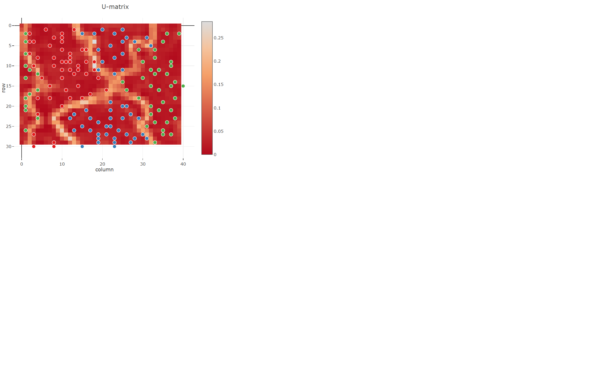
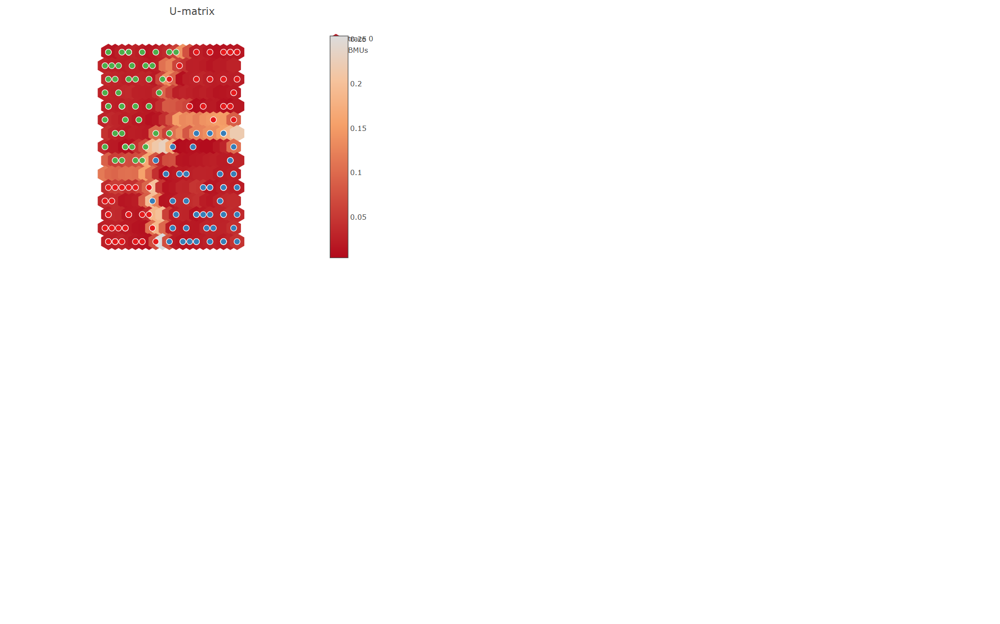
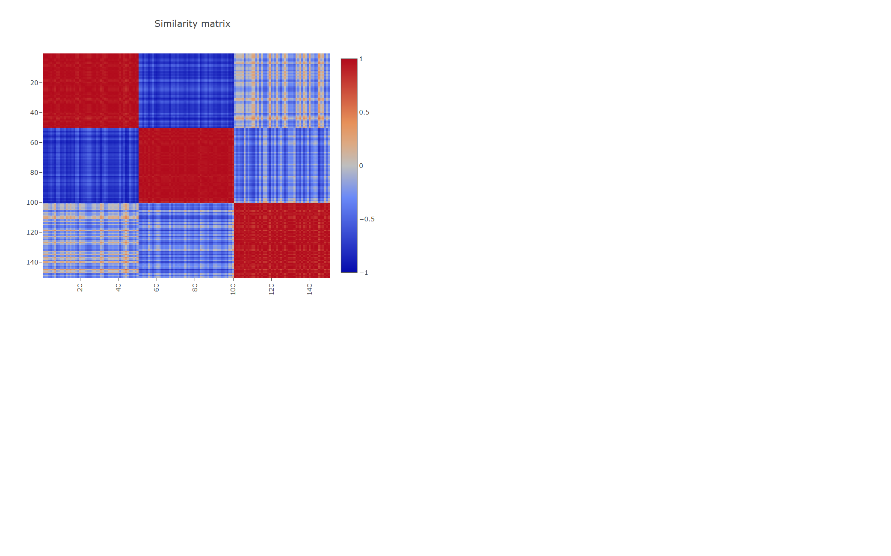
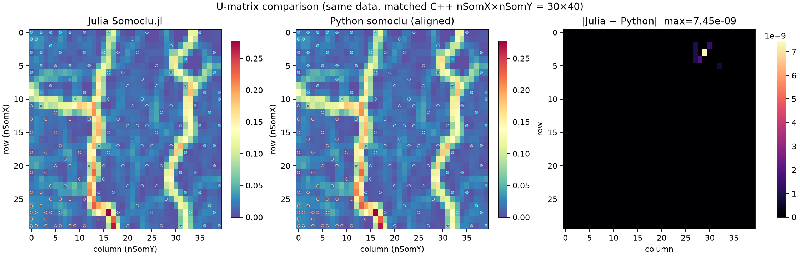

# Visualization

Plot helpers return [PlotlyLight](https://github.com/JuliaComputing/PlotlyLight.jl)
figures (interactive HTML). Pass `filename="…"` to write a standalone HTML file.

```julia
using Somoclu, Random
Random.seed!(1)

som = Som(40, 30; maptype="toroid", gridtype="rectangular")
train!(som, rand(Float32, 2, 150); epochs=10)

view_umatrix(som; bestmatches=true, colorbar=true)
view_component_planes(som; dimensions=1:2)
view_activation_map(som; data_index=1)
view_similarity_matrix(som)

view_umatrix(som; filename="umatrix.html")
```

## Example figures

U-matrix on a rectangular toroid map (`view_umatrix`, with BMUs):



Hexagonal grid U-matrix (`gridtype="hexagonal"` / legacy `"square"` distances):



Sample–sample similarity of activation vectors (`view_similarity_matrix`):



Julia vs Python U-matrix on matched data (numerical check):



## Helpers

- [`codebook_plane`](@ref) — reshape one codebook dimension to the map grid
- [`get_surface_state`](@ref) — distances from samples to all neurons
